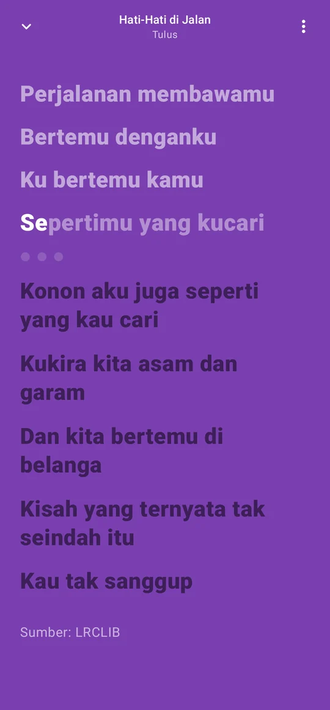
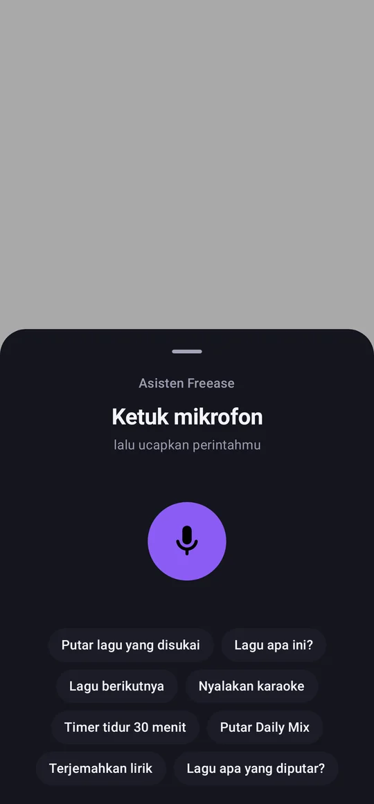
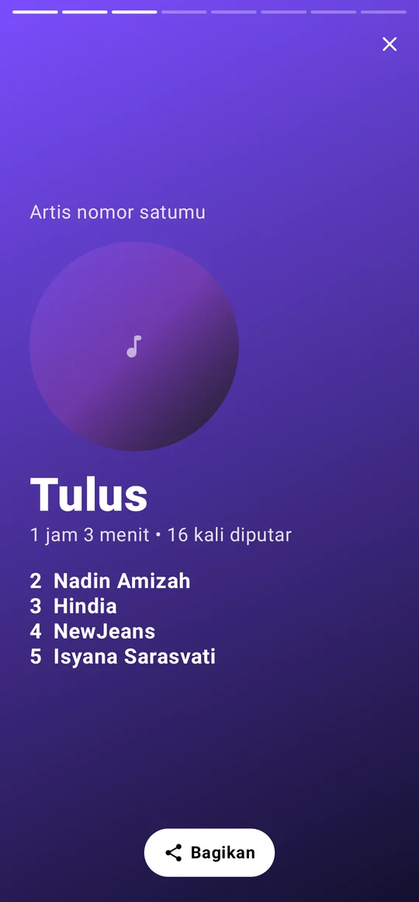
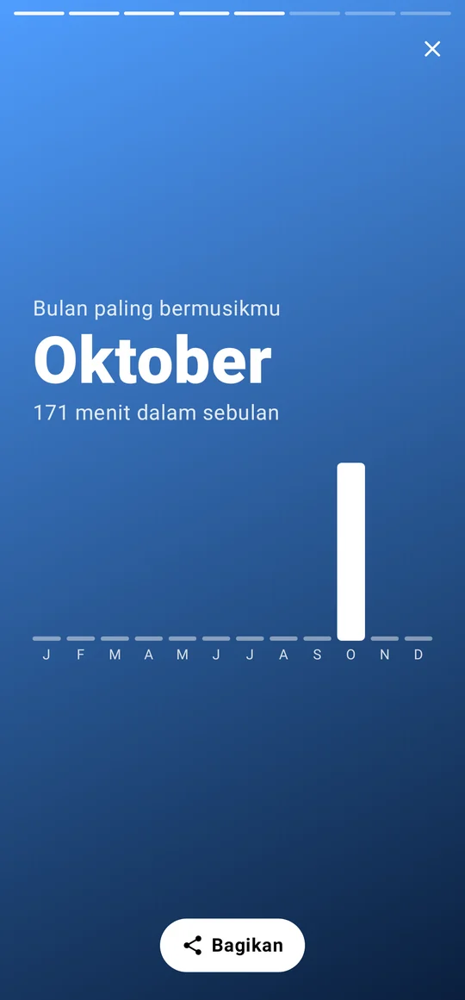

<div align="center">


<br>

[](https://github.com/Kodok-Kejepit/Freease-Music/releases/latest)


[](https://github.com/Kodok-Kejepit/Freease-Music/releases/latest)
&nbsp;
[](https://freease.cloud)

</div>

<br>

Freease itu aplikasi musik yang aku bikin buat dipakai sendiri, karena capek sama iklan yang muncul tiap ganti lagu.
Lagunya diambil dari YouTube dan YouTube Music, tapi diputar langsung dari berkas aslinya, jadi iklannya nggak
pernah ikut. Nggak perlu akun, nggak ada langganan, dan semua koleksi kamu tersimpan di HP kamu sendiri.

Lama-lama fiturnya nambah terus: lirik yang jalan sesuai lagu, mode karaoke, asisten suara yang ngerti bahasa
Indonesia, sampai bisa nonton video YouTube apa aja tanpa iklan.

## Yang bisa dilakukan

**Dengerin musik**
- Cari lagu, artis, album, atau playlist. Hasilnya bisa di-scroll terus
- Tetap jalan di latar belakang, bisa dikontrol dari notifikasi dan layar kunci
- Equalizer, bass boost, normalisasi volume, atur kecepatan dan nada
- Unduh lagu buat didengar offline, atau putar musik yang sudah ada di HP
- Bagian yang bukan musik di video klip, misalnya intro ngobrol, dilewati otomatis

**Lirik dan karaoke**
- Lirik berjalan, bisa melayang di atas aplikasi lain atau tampil di layar kunci
- Terjemahan bahasa Indonesia di bawah tiap baris lirik
- Mode karaoke pakai AI yang jalan langsung di HP, plus skor nyanyi dan rekam suara

**Video**
- Ganti dari mode lagu ke video kapan aja, kualitas sampai 1080p, tanpa iklan
- Layar penuh dan Picture-in-Picture

**Lainnya**
- Freease Smart: bilang "oke Freease, putar Tulus" dan langsung jalan
- Playlist, folder, playlist pintar, statistik, sampai rekap tahunan
- Widget layar utama, Android Auto, alarm musik, dan kenali lagu yang lagi diputar di sekitar
- Cadangan koleksi yang bisa dipindah ke versi web, dan sebaliknya

Daftar lengkapnya ada di [android/README.md](android/README.md).

## Tampilan

<div align="center">






</div>

## Unduh

Ambil berkas `Freease-x.x.x.apk` terbaru di halaman [Releases](https://github.com/Kodok-Kejepit/Freease-Music/releases/latest),
buka di HP, lalu pasang. Kalau HP minta izin pasang dari sumber tidak dikenal, izinkan saja.

Minimal Android 8.0. Versi baru bisa langsung dipasang di atas versi lama, koleksi kamu tetap aman.

## Versi web

Kalau lagi di laptop atau pakai iPhone, Freease juga bisa dibuka lewat browser di **[freease.cloud](https://freease.cloud)**.
Di versi web kamu bahkan bisa nonton video YouTube apa aja, dari film sampai kartun.


Tampilannya menyesuaikan layar, dari HP sampai monitor lebar. Selain dengerin musik, di versi web kamu bisa pilih
mau cari di YouTube Music atau YouTube biasa, nonton video dengan subtitle terjemahan Indonesia, dan pasang
Freease ke layar utama biar kebuka kayak aplikasi (Chrome: menu, lalu Tambahkan ke layar utama).

Untuk sekarang versi web masih pakai kata sandi. Kalau mau coba, hubungi aku aja.

## Build sendiri

Butuh JDK 17 dan Android SDK 35.

```bash
git clone https://github.com/Kodok-Kejepit/Freease-Music.git
cd Freease-Music/android
./gradlew assembleDebug
```

APK-nya ada di `app/build/outputs/apk/debug/`. APK rilis di halaman Releases dibuat otomatis lewat GitHub Actions
([build-apk.yml](.github/workflows/build-apk.yml)). Kalau mau build rilis sendiri, bikin `android/keystore.properties`
berisi `storeFile`, `storePassword`, `keyAlias`, dan `keyPassword`, lalu jalankan `./gradlew assembleRelease`.

## Soal privasi

Freease nggak punya akun dan nggak melacak apa pun. Riwayat, playlist, unduhan, dan pengaturan semuanya disimpan
di perangkat kamu. Untuk melewati sponsor, Freease cuma mengirim 4 karakter awal dari kode acak video ke
SponsorBlock, jadi mereka nggak tahu video apa yang kamu tonton.

## Bikin bareng

Nemu bug atau punya ide fitur? Tulis aja di [Issues](https://github.com/Kodok-Kejepit/Freease-Music/issues).
Pull request juga boleh banget. Sebelum kirim, jalankan dulu `./gradlew testDebugUnitTest` di folder `android`.

## Tentang aku

<table>
<tr>
<td width="110" valign="top"></td>
<td valign="top">

Aku [Kodok-Kejepit](https://github.com/Kodok-Kejepit), suka bongkar cara kerja sesuatu terus bikin versi sendiri.
Proyek lain yang juga lagi aku kerjain:

- [JawaRustGo++](https://jawarustgoplusplus.web.id), bahasa pemrograman dengan pesan error berbahasa Indonesia, ditulis pakai Rust ([kode](https://github.com/Kodok-Kejepit/jrg))
- [Freease OSINT Tool](https://github.com/Kodok-Kejepit/freease), tool recon dan audit keamanan berbasis terminal

Kalau Freease kepake buat kamu, kasih bintang di repo ini ya. Itu cukup bikin semangat.

</td>
</tr>
</table>

## Catatan

Freease proyek pribadi dan nggak ada hubungannya dengan YouTube atau Google. Lagu, video, dan lirik tetap milik
pemiliknya masing-masing, jadi tetap dukung artis favoritmu.

Dirilis dengan lisensi [MIT](LICENSE).

<div align="center">
<br>

</div>
