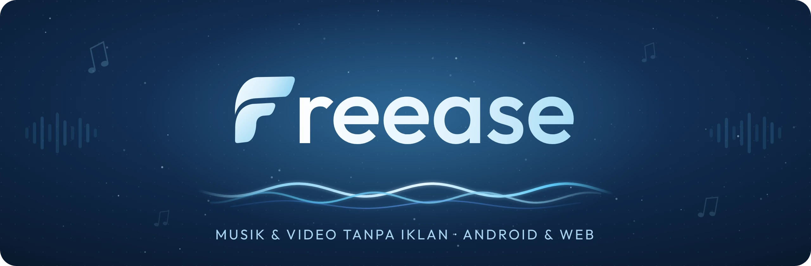
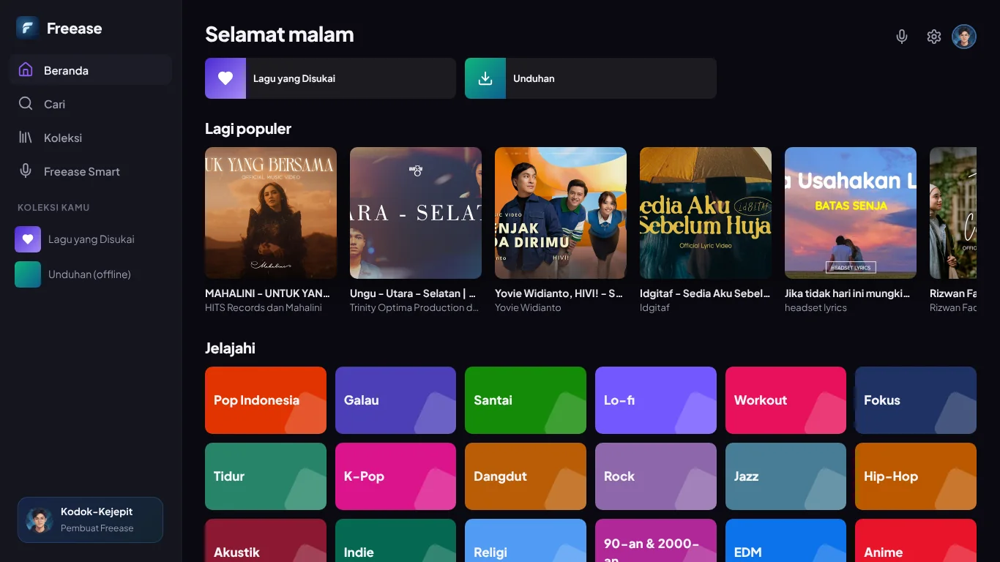
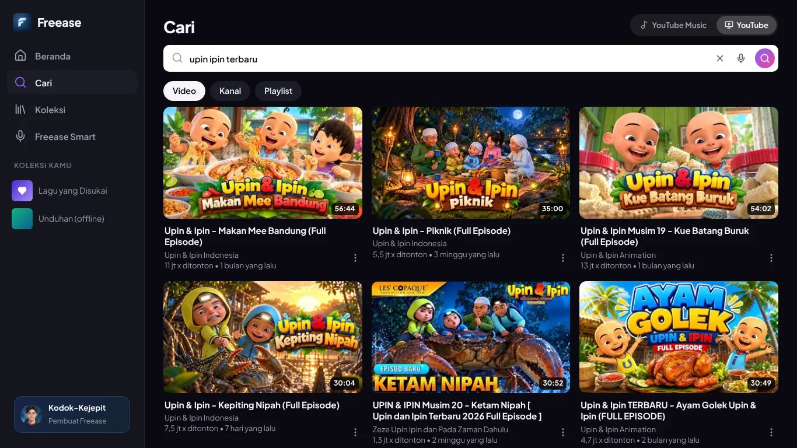
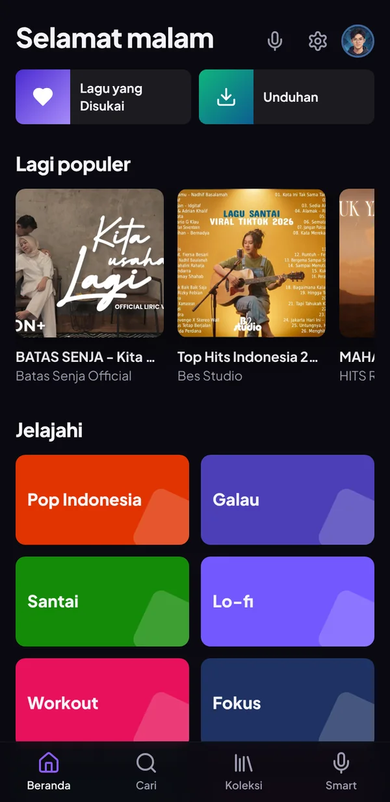
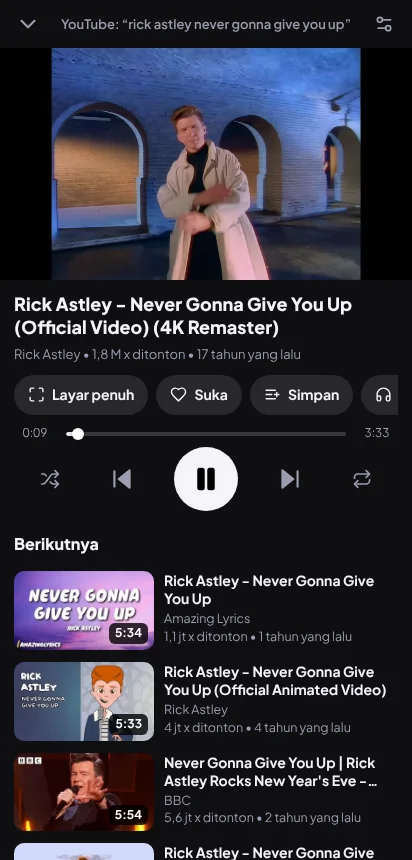
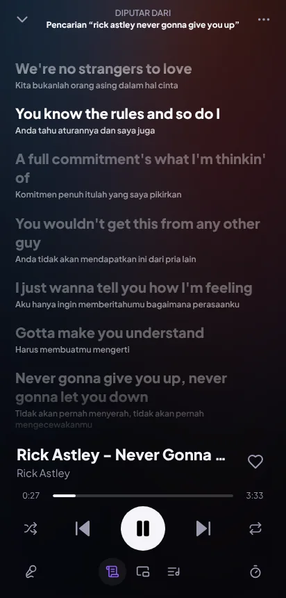
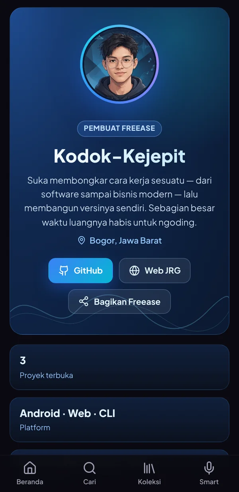

<div align="center">



<br>

**Dengar musik dan nonton video sepuasnya — tanpa iklan, tanpa langganan, tanpa akun.**<br>
Lirik berjalan, karaoke, subtitle terjemahan Indonesia, dan asisten suara berbahasa Indonesia.<br>
Semua koleksi dan riwayatmu tersimpan di perangkatmu sendiri.

<br>

[](https://github.com/Kodok-Kejepit/freease-music/releases/latest)


<br>

[](https://github.com/Kodok-Kejepit/freease-music/releases/latest)
&nbsp;
[](https://freease.cloud)

[**Fitur**](#fitur) &nbsp;·&nbsp; [**Tampilan**](#tampilan) &nbsp;·&nbsp; [**Unduh**](#unduh-apk) &nbsp;·&nbsp; [**Freease Web**](#freease-web) &nbsp;·&nbsp; [**Privasi**](#privasi--100-tanpa-iklan) &nbsp;·&nbsp; [**Pembuat**](#pembuat)

</div>

<br>

## Kenapa Freease?

<table>
<tr>
<td width="33%" valign="top">

### Bersih dari iklan
Lagu dan video diambil sebagai berkas mentah, bukan lewat player YouTube — jadi iklan tidak pernah tayang. Sponsor yang direkam di dalam video pun dilewati otomatis.

</td>
<td width="33%" valign="top">

### Terasa lokal
Antarmuka, asisten suara, lirik terjemahan, sampai subtitle video — semuanya berbahasa Indonesia. Bilang saja *"oke Freease, putar Tulus"*.

</td>
<td width="33%" valign="top">

### Datamu milikmu
Tanpa akun dan tanpa pelacakan. Koleksi, playlist, unduhan, dan riwayat disimpan di HP atau browser-mu, bukan di server.

</td>
</tr>
</table>

## Fitur

| | Android | Web |
|---|:---:|:---:|
| Cari lagu, video, artis, album, playlist — hasil terus dimuat saat di-scroll | Ya | Ya |
| Mode **YouTube Music** (lagu) dan **YouTube** (semua video: film, kartun, vlog) | Ya | Ya |
| Putar di latar belakang, kontrol di notifikasi & layar kunci | Ya | Ya |
| Video tanpa iklan sampai 4K, layar penuh, Picture-in-Picture | Ya | Ya |
| Lirik berjalan, lirik melayang, lirik di layar kunci, **terjemahan Indonesia** | Ya | Ya |
| **Subtitle video** + terjemahan Indonesia otomatis | | Ya |
| Mode Karaoke | Ya (AI) | Beta |
| Skor nyanyi & rekam suara saat karaoke | Ya | |
| **Freease Smart** — asisten suara bahasa Indonesia, *"oke Freease"* tanpa tombol | Ya | Ya |
| Equalizer, bass boost, normalisasi volume, kecepatan & nada | Ya | Ya |
| Unduh untuk didengar offline, putar musik & video dari HP | Ya | Ya |
| Lewati sponsor otomatis (SponsorBlock), lanjutkan menonton dari posisi terakhir | Ya | Ya |
| Playlist, folder, playlist pintar, statistik & rekap tahunan | Ya | Ya |
| Widget layar utama, Android Auto, alarm musik, kenali lagu | Ya | |
| Cadangan koleksi — **formatnya sama**, bisa pindah dari Android ke Web dan sebaliknya | Ya | Ya |

Daftar lengkap fitur aplikasi Android ada di [`android/README.md`](android/README.md).

## Tampilan

<div align="center">




<br><br>






</div>

## Unduh APK

1. Buka halaman **[Releases](https://github.com/Kodok-Kejepit/freease-music/releases/latest)**, lalu unduh berkas `Freease-x.x.x.apk`.
2. Buka berkasnya di HP. Bila diminta, izinkan pemasangan dari sumber ini.
3. Selesai — buka **Freease** dan mulai dengarkan.

Butuh **Android 8.0** ke atas. Versi baru bisa langsung dipasang menimpa versi lama tanpa kehilangan koleksi.

## Freease Web

<table>
<tr>
<td width="62%" valign="top">

Tidak pakai Android, atau sedang di laptop? Buka Freease langsung dari browser:

### [freease.cloud](https://freease.cloud)

- Jalan di **HP, tablet, laptop, dan komputer** — Android, iPhone, Windows, macOS, maupun Linux
- Mode **YouTube Music** untuk lagu dan **YouTube** untuk semua video, lengkap dengan layar tonton ala YouTube
- **Subtitle video dengan terjemahan Indonesia**, lirik berjalan, lirik melayang, dan Freease Smart
- Bisa dipasang seperti aplikasi: di Chrome pilih menu ⋮ → **Tambahkan ke layar utama**
  (iPhone: Safari → Bagikan → **Tambahkan ke Layar Utama**)
- Koleksi bisa dipindah dari dan ke aplikasi Android lewat menu **Cadangkan / Pulihkan**

Saat ini Freease Web memakai kata sandi — hubungi pembuat untuk mendapatkan akses.

</td>
<td width="38%" valign="top" align="center">

</td>
</tr>
</table>

## Build dari kode sumber

Aplikasi native: **Kotlin · Jetpack Compose · Media3 (ExoPlayer) · ONNX Runtime**. Butuh JDK 17+ dan Android SDK 35.

```bash
git clone https://github.com/Kodok-Kejepit/freease-music.git
cd freease-music/android
./gradlew assembleDebug      # → app/build/outputs/apk/debug/app-debug.apk
```

APK rilis di halaman Releases dibuat otomatis oleh GitHub Actions ([`.github/workflows/build-apk.yml`](.github/workflows/build-apk.yml)).
Untuk membuat APK rilis sendiri, buat `android/keystore.properties` (tidak ikut repo):

```properties
storeFile=../freease-release.jks
storePassword=…
keyAlias=…
keyPassword=…
```

lalu jalankan `./gradlew assembleRelease`.

## Privasi & 100% tanpa iklan

- **Tanpa player YouTube.** Iklan YouTube hanya disisipkan oleh player resminya; Freease tidak pernah memakainya.
  Yang diputar adalah berkas audio & video aslinya.
- **Sponsor di dalam video** dilewati lewat data komunitas SponsorBlock. Hanya 4 karakter awal hash id video yang
  dikirim, jadi layanan itu tidak tahu video apa yang ditonton.
- **Tanpa akun & pelacakan.** Riwayat, koleksi, unduhan, lirik, dan pengaturan disimpan di perangkatmu sendiri —
  di aplikasi maupun di Freease Web.

## Struktur

```
freease-music/
├── android/              Aplikasi Android (Kotlin, Jetpack Compose, Media3)
├── docs/                 Banner, logo & tangkapan layar
└── .github/workflows/    Build APK otomatis ke halaman Releases
```

## Kontribusi

Laporan bug, ide fitur, dan pull request sangat diterima — buka lewat
[Issues](https://github.com/Kodok-Kejepit/freease-music/issues). Sebelum mengirim perubahan:

```bash
cd android && ./gradlew testDebugUnitTest
```

## Pembuat

<table>
<tr>
<td width="120" align="center" valign="top">

</td>
<td valign="top">

**[Kodok-Kejepit](https://github.com/Kodok-Kejepit)** — suka membongkar cara kerja sesuatu, lalu membangun versinya sendiri.

Proyek lainnya:
- **[JawaRustGo++](https://jawarustgoplusplus.web.id)** — bahasa pemrograman dengan pesan galat berbahasa Indonesia, ditulis dengan Rust. ([kode sumber](https://github.com/Kodok-Kejepit/jrg))
- **[Freease OSINT Tool](https://github.com/Kodok-Kejepit/freease)** — tool recon & audit attack surface berbasis terminal.

Suka proyek ini? Beri bintang di GitHub dan bagikan ke teman-temanmu.

</td>
</tr>
</table>

## Catatan

Freease adalah proyek pribadi dan tidak berafiliasi dengan YouTube maupun Google. Semua lagu, video, dan lirik
tetap milik pemiliknya masing-masing. Gunakan untuk keperluan pribadi dan dukung artis favoritmu.

## Lisensi

[MIT](LICENSE) © 2026 Kodok-Kejepit

<div align="center">
<br>

</div>
