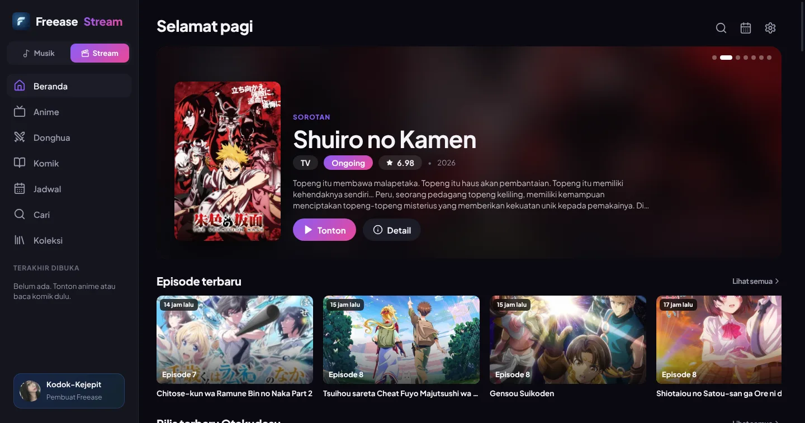

# Freease Web

Ini kode versi web Freease, yang sama persis dengan yang jalan di [freease.cloud](https://freease.cloud).
Begitu dibuka, kamu tinggal pilih mau ke mana:

- **Freease Musik**: dengerin lagu dan video musik dari YouTube dan YouTube Music tanpa iklan, lengkap sama lirik
  berjalan, karaoke, terjemahan lirik, equalizer, dan asisten suara.
- **Freease Stream**: nonton anime dan donghua subtitle Indonesia, sama baca manga, manhwa, dan manhua.

Tampilannya nyesuaikan layar, dari HP sampai monitor lebar, dan bisa dipasang ke layar utama biar kebuka kayak
aplikasi.



## Freease Stream

**Anime**
- Sumbernya Animekompi dan Otakudesu, jadi episode baru biasanya udah ada di hari yang sama
- Jelajah per genre, status, dan urutan, plus jadwal rilis per hari dalam WIB
- Kalau server di satu sumber lagi kosong, ada tombol buat pindah ke judul yang sama di sumber lain

**Donghua**
- Punya menu sendiri, sumbernya Anichin dan Animekompi
- Banyak episode yang tersedia sampai 1080p

**Komik**
- Komiku, Shinigami, Komikindo, Bacakomik, WEBTOON (Indonesia), MangaPark dan MangaGoku (Inggris)
- Mode gulir buat manhwa dan webtoon, mode per halaman buat manga, halaman terakhir diingat
- Terjemahan ke bahasa Indonesia langsung di atas balon kata. Teks di gambar dibaca di perangkat kamu sendiri,
  jadi nggak perlu akun dan nggak ada batas pemakaian

**Pemutarnya**
- Pemutar sendiri: ganti server dan kualitas, lanjut dari menit terakhir, episode berikutnya otomatis, lewati
  intro, kecepatan putar, Picture-in-Picture, ketuk dua kali buat maju/mundur 10 detik
- Koleksi, riwayat, dan posisi nonton disimpan di browser, bisa dicadangkan ke berkas

## Soal iklan

Freease nggak pernah pakai player YouTube resmi. Lagu dan video diambil sebagai berkas mentah lewat server, jadi
iklan yang biasanya disisipkan player-nya nggak pernah ikut.

Di Freease Stream, server video dari situs lain juga dibuka jadi berkas video biasa lalu diputar pakai pemutar
Freease. Ada beberapa server yang cuma bisa diputar lewat pemutar mereka sendiri. Server kayak gitu cuma dipakai
kalau server lain gagal, dan selalu dikunci pakai sandbox: jendela iklan, pindah halaman diam-diam, sama unduhan
otomatis diblokir browser. Situs juga cuma ngizinin iframe dari pemutar yang udah dicek, sisanya nggak bisa dimuat
sama sekali. Server yang nolak jalan di sandbox nggak dipakai.

Tes `client/src/noAds.test.ts` bakal gagal kalau ada kode yang masang player YouTube, skrip iklan, atau iframe
tanpa sandbox.

## Jalanin di komputer sendiri

Butuh Node.js 20+ dan [yt-dlp](https://github.com/yt-dlp/yt-dlp#installation).

```bash
git clone https://github.com/Kodok-Kejepit/Freease-Music.git
cd Freease-Music/web/client && npm ci && npm run build
cd ../server && npm ci && npm start          # buka http://localhost:8080
```

Kalau lagi ngubah tampilan, jalankan `npm run dev` di `server/` dan di `client/`, lalu buka http://localhost:5173.

## Pasang di VPS

VPS **1 vCPU / 1 GB RAM** (Ubuntu atau Debian) udah cukup buat dipakai sendiri atau bareng beberapa teman.

```bash
git clone https://github.com/Kodok-Kejepit/Freease-Music.git
cd Freease-Music/web
sudo bash install.sh                       # http://IP-VPS:8080
sudo bash install.sh musik.domainmu.com    # https://musik.domainmu.com (arahkan DNS ke IP VPS dulu)
```

Skrip ini nambah swap kalau RAM-nya kecil, masang Docker, bikin `.env` dengan kata sandi acak, ngejalanin Freease
(plus penyedia PO Token dan HTTPS kalau pakai domain), terus langsung ngetes apakah IP VPS kamu diblokir YouTube.
Kata sandi dan alamatnya dicetak di akhir.

Kalau di VPS-mu udah ada web lain dengan reverse proxy sendiri (misalnya Caddy atau Nginx), pakai
`sudo bash install-systemd.sh` aja. Freease dipasang sebagai layanan systemd di `127.0.0.1:8080` tanpa Docker,
jadi aturan firewall kamu nggak keganggu. Tinggal arahkan reverse proxy ke alamat itu. Sebelum menjalankannya,
build dulu tampilannya (`cd client && npm ci && npm run build`). Kata sandinya ada di `/opt/freease/.env`.

- Ganti kata sandi: `sudo bash ganti-password.sh` (versi Docker)
- Update ke versi terbaru: `sudo bash update.sh` (versi Docker), atau `git pull`, build `client` lagi, lalu
  `sudo bash install-systemd.sh` (versi systemd)
- Amankan VPS (firewall, fail2ban, update keamanan otomatis): `sudo bash secure.sh`
- Cek kesehatan dari VPS: `curl -s localhost:8080/api/diagnose`

Pemakaian RAM sekitar 250 sampai 450 MB.

### Pengaturan

Semua diatur lewat `.env` (contohnya di `.env.example`).

| Variabel | Fungsi |
|---|---|
| `FREEASE_PASSWORD` | Kata sandi masuk. Sangat disarankan, biar bandwidth server nggak dipakai orang lain |
| `FREEASE_SECRET` | Teks acak panjang buat cookie login dan tautan video |
| `FREEASE_REGION` / `FREEASE_LANG` | Wilayah dan bahasa hasil YouTube (bawaan `ID` / `id`) |
| `PORT` / `HOST` | Port dan alamat server (bawaan 8080, semua alamat) |
| `POT_PROVIDER_URL` | Alamat penyedia PO Token, misalnya `http://127.0.0.1:4416` |
| `YT_COOKIES_FILE` | Berkas cookies YouTube kalau server tetap diblokir |
| `YTDLP_PATH` / `YTDLP_CONCURRENCY` | Lokasi yt-dlp dan jumlah proses yang boleh jalan bareng |
| `FS_OTAKUDESU_URL` / `FS_ANICHIN_URL` | Alamat Otakudesu dan Anichin kalau domainnya pindah |
| `DOMAIN` | Domain buat HTTPS otomatis (dipakai `install.sh`) |
| `RATE_LIMIT_PER_MIN` | Batas permintaan per IP per menit (bawaan 600) |

## Kalau YouTube blokir IP VPS

IP pusat data sering kena *"Sign in to confirm you're not a bot"*. Yang bisa dicoba:

1. **PO Token**. Udah dipasang otomatis sama `install.sh` dan `install-systemd.sh`, dan yt-dlp diperbarui tiap
   layanan dinyalakan.
2. **Cookies**. Ekspor cookies `youtube.com` dari browser pakai akun cadangan, simpan sebagai
   `data/cookies.txt`, isi `YT_COOKIES_FILE`, lalu nyalakan ulang.
3. **Server di rumah**. PC, laptop, atau STB dengan IP rumahan, terus dibuka lewat Cloudflare Tunnel.

Beberapa sumber anime dan komik juga nolak IP pusat data. Sumber yang ada di Freease udah dicek jalan dari VPS.

## Data kamu

Koleksi, playlist, riwayat, unduhan, posisi nonton, dan pengaturan semuanya disimpan di browser masing-masing,
bukan di server. Server cuma nyimpan cache kecil di RAM yang kebuang sendiri. Mau pindah perangkat? Pakai
**Pengaturan, Cadangkan / Pulihkan**. Berkas cadangannya juga bisa dipulihkan di aplikasi Android.

## Tes

```bash
cd server && npm test
cd client && npm test
```
